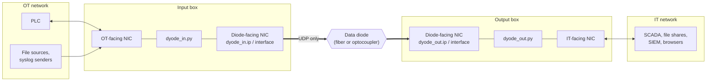
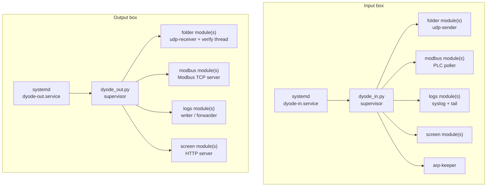
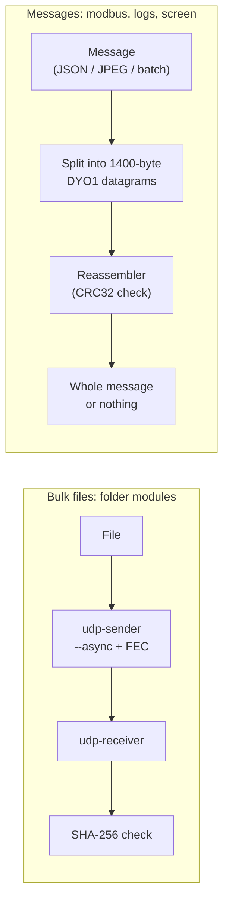

# Architecture

DYODE is two programs that never talk to each other directly. The
**input box** runs `dyode_in.py` and sends. The **output box** runs
`dyode_out.py` and receives. Both read the **same `config.yaml`**, so each
side knows the other's addresses and every module's ports.

## Boxes and networks

The input box can talk normally to its OT network: it polls PLCs over TCP
and accepts syslog. The output box serves its IT network normally. Only
the diode link itself is one-way.

## Processes on each box

Each side starts a small **supervisor**. It runs every configured module in
its own process and restarts any that crash, after a 5-second guard against
tight crash loops. systemd in turn restarts the supervisor
(`Restart=always`), so DYODE recovers from both module crashes and its own.

### The ARP keeper (input box)

A normal network learns the other side's MAC address with ARP, which is
a question and an answer. Through a diode the answer can never come back.
Without a MAC address, the input box's own kernel silently drops every
packet, while `udp-sender` still reports success.

DYODE therefore pins the output box's MAC (`dyode_out.mac`) as a
**permanent neighbor entry**. The `arp-keeper` process re-asserts it every
`arp_interval` seconds (default 60), because the entry is lost whenever
the NIC goes down and comes back. If the entry cannot be set at start-up,
`dyode_in.py` **refuses to start**, so systemd retries until the interface
is ready, rather than running and moving nothing.

The generated systemd unit is also bound to the diode NIC (`BindsTo=`).
DYODE stops when the NIC disappears and starts again when it returns. It
also waits for the interface to have its address before starting.

## Two transports

**Files** use [udpcast](https://www.udpcast.linux.lu/) (`udp-sender` /
`udp-receiver`) in asynchronous mode with forward error correction (FEC).
The sender adds repair data so the receiver can rebuild lost packets
without asking. See [Folder Transfers](Folder-Transfers).

**Messages** (Modbus values, log batches, screenshots) use DYODE's own UDP
framing. Every datagram carries a header:

| Field | Size | Purpose |
|---|---|---|
| magic `DYO1` | 4 B | Ignore stray traffic |
| message id | 4 B | Group the datagrams of one message |
| index / total | 2 + 2 B | Reassemble in any order |
| CRC32 of the whole message | 4 B | Reject a corrupted message |

The payload is at most 1400 bytes, so each datagram fits in one Ethernet
frame with no IP fragmentation. A message with any missing piece is
dropped whole, never delivered half-corrupted.

**DYODE v2** replaces the Ethernet link with a serial line through an
optocoupler. One process owns the serial port and multiplexes all Modbus
modules over it as tagged, newline-delimited JSON messages.

## Code map

| File | Role |
|---|---|
| `DYODE_v1_full/dyode_in.py`, `dyode_out.py` | Entry points: load config, start the supervisor and modules |
| `DYODE_v1_full/dyode.py` | Folder transfers: udpcast wrapper, manifests, receiver state machine, ARP keeper |
| `DYODE_v1_full/modbus.py` | Modbus poller and mirror (also copied into `DYODE_v2_light/in` and `out`) |
| `DYODE_v1_full/logstream.py` | Log streaming |
| `DYODE_v1_full/screen.py` | Screen sharing |
| `DYODE_v1_full/dyode_common.py` | Config loading and validation, logging, JSON events, supervisor, UDP framing |
| `dyode_setup.py`, `dyode_setup_core.py` | Setup wizard: interfaces, MAC addresses, `config.yaml`, systemd unit |
| `install.sh`, `lib/*.sh` | Installer: OS packages, virtualenv, wheels, file shares, kernel tuning |
| `dyode_logs.py` | Weekly log archiving and transfer statistics |
| `packaging/` | Offline bundle (`.deb`s and wheels), logrotate and systemd files |
