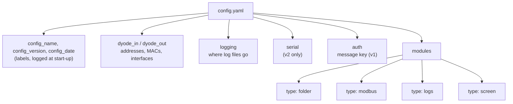

# Configuration Reference

Both boxes read the **same** `config.yaml`. In v1 it lives in
`DYODE_v1_full/`; in v2 each side's folder has its own copy, with the same
contents. The setup wizard writes it for you. This page lists every key.
DYODE validates the whole file at start-up and stops with a clear message
on any mistake, rather than silently ignoring a typo.



## Network

```yaml
dyode_in:
  ip: 10.0.1.1
  mac: b8:27:eb:89:1e:f3
  interface: eth0        # NIC facing the diode on the input box
  arp_interval: 60       # seconds between re-asserting the static ARP entry
dyode_out:
  ip: 10.0.1.2
  mac: b8:27:eb:b1:ff:ab # pinned on the input box (no ARP replies through a diode)
  interface: eth1        # NIC facing the diode on the output box
```

## Authentication (v1)

```yaml
auth:                    # optional; these are the defaults
  key_file: dyode.key    # relative to config.yaml's folder
  required: true         # false: run unsigned, with a warning
```

The **same** `dyode.key` must be on both boxes. See [Security](Security).

## Logging

```yaml
logging:
  dir: /var/log/dyode-transfer   # "" = stderr only (journalctl)
  human: dyode.log               # every module, human-readable
  json: transfer.jsonl           # one JSON event per line
  per_file_events: true          # false = batch summaries only
```

## Serial (v2 only)

```yaml
serial:
  device: /dev/serial0
  baudrate: 57600                # must match on both sides
```

## Module: `folder`

| Key | Default | Meaning |
|---|---|---|
| `port` | *required* | udpcast port base (unique per module) |
| `in` | *required* | Folder watched on the input box |
| `out` | *required* | Folder files are delivered to on the output box |
| `bitrate` | 8 ÷ number of folder modules | Mbit/s cap, including FEC and headers |
| `fec` | `8x16/64` | FEC ratio, or `none`. Stronger FEC (for example `8x32/64`) costs bandwidth. |
| `settle` | `2` | Seconds a file must be unchanged before it is sent |
| `file_gap` | `0.5` | Seconds between files |
| `autostart` | `5` | Hello packets sent before data. This is the receiver's only grace period. |
| `start_timeout` | `300` | Receiver idle timeout before re-opening. `0` means wait forever. |
| `batch_timeout` | `300` | Seconds with nothing arriving before an incomplete batch is closed |
| `keep_sent_hours` | `24` | Keep sent files in `.dyode_sent`. `0` deletes them at once. |
| `staging` | `<out>.incoming` | Where transfers land before verification. Must be outside `out`, on the same filesystem. |

## Module: `modbus`

| Key | Default | Meaning |
|---|---|---|
| `port` | *required* | UDP port through the diode |
| `ip` | *required* | PLC address (input box) |
| `registers`, `coils` | at least one | Ranges `start-end`, end excluded |
| `plc_port`, `unit` | `502`, `1` | PLC's TCP port and Modbus unit id |
| `interval` | `1.0` | Seconds between polls |
| `port_out`, `bind_out` | `502`, `0.0.0.0` | Modbus server on the output box |
| `unmapped` | `exception` | Reads outside the ranges: exception 02, or `zero` |
| `stale_after` | `10` | Warn after this many seconds without updates |

## Module: `logs`

| Key | Default | Meaning |
|---|---|---|
| `port` | *required* | UDP port through the diode |
| `listen_udp`, `listen_tcp`, `tail` | at least one | Sources on the input box |
| `allow_from` | anyone (the wizard warns) | Networks allowed to send syslog |
| `out`, `forward` | at least one | Destinations on the output box |
| `format` | `prefixed` | `prefixed`, `raw` or `json` |
| `split_by_source` | `false` | One file per sending host |
| `copies` | `2` | Times each batch is sent (1–4) |
| `max_kbps` | `2000` | Bandwidth cap for this module |
| `heartbeat`, `stale_after` | `10`, `30` | Keep-alive interval, and the silence warning |
| `tail_from`, `tail_state` | `end`, *none* | Where tailing starts, and where offsets are saved |

## Module: `screen`

| Key | Default | Meaning |
|---|---|---|
| `port` | *required* | UDP port through the diode |
| `in` | *required* | Folder of JPEG screenshots (input box) |
| `out` | *required* | Must be set; the output side serves frames from memory |
| `http_port`, `http_bind` | `8080`, IT-side address | Web server on the output box; `http_bind` defaults to the first address not on the diode NIC |
| `max_streams` | `8` | Viewers at once; more get HTTP 503 |
| `max_fps` | `10` | Frame rate cap |

## A complete example

```yaml
config_name: "Plant A diode"
config_version: 1.0
config_date: 2026-10-19

dyode_in:  {ip: 10.0.1.1, mac: "b8:27:eb:89:1e:f3", interface: eth1}
dyode_out: {ip: 10.0.1.2, mac: "b8:27:eb:b1:ff:ab", interface: eth1}

modules:
  "Reports":
    type: folder
    port: 9600
    in: /srv/dyode/in
    out: /srv/dyode/out
    bitrate: 900
  "Line 1 PLC":
    type: modbus
    port: 9400
    ip: 192.168.1.150
    registers: [0-100]
    coils: [0-10]
  "OT logs":
    type: logs
    port: 9700
    listen_udp: 514
    out: /var/log/dyode-ot
```

The commented template with every option is
[`config.example.yaml`](https://github.com/nc-intezra/dyode_python3/blob/master/DYODE_v1_full/config.example.yaml).
