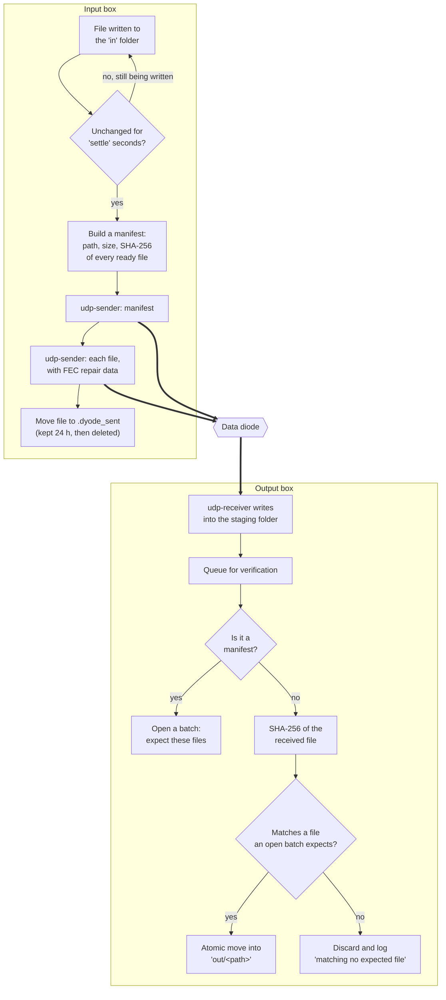
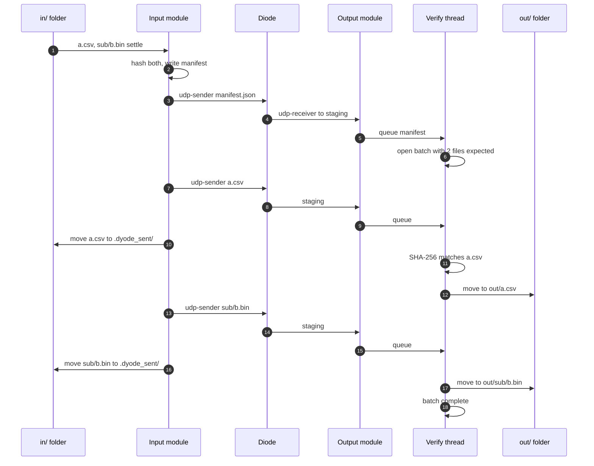
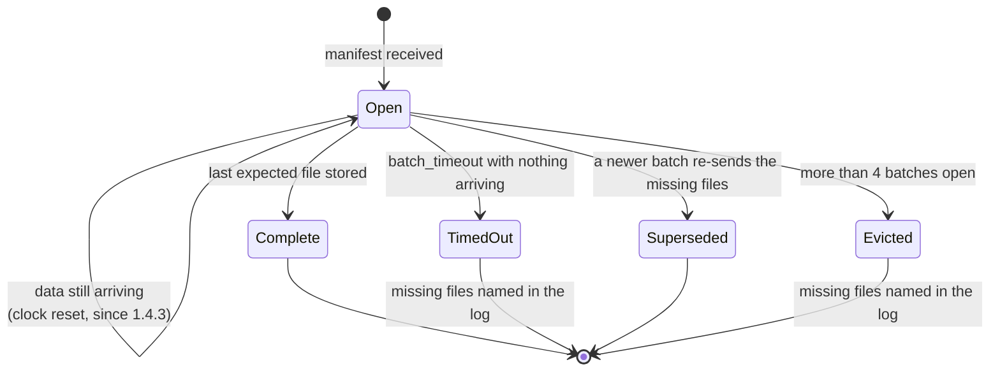
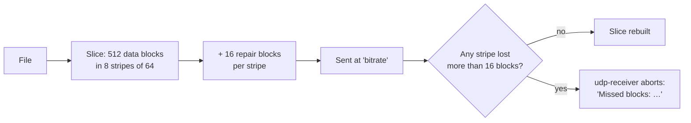
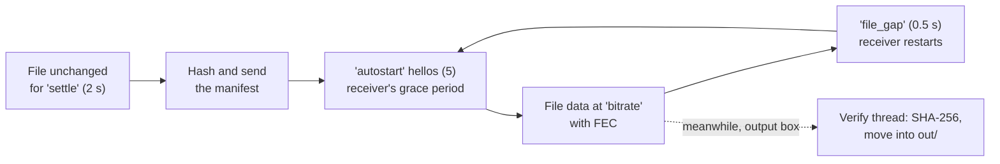

# Folder Transfers

A `folder` module copies files from a folder on the input box to a folder on
the output box, keeping subfolders. It is the main way to move data through
the diode: reports, exports, backups, images, files of any size (tested to
10 GB).

## The journey of a file



### Step by step

1. **Pick up.** The input module watches its `in` folder, using inotify,
   with a full rescan every 30 s as a fallback. A file is sent once it has
   not changed for `settle` seconds (default 2), so half-written files wait.
   Symbolic links are never followed or sent, so a link cannot be used to
   leak a file from elsewhere on the input box.
2. **Manifest.** All ready files form one **batch**. DYODE hashes each one
   and sends a JSON **manifest** first: a batch id, plus each file's relative
   path, size and SHA-256.
3. **Send.** Each file is sent with `udp-sender --async`, with forward error
   correction (`fec`, default `8x16/64`) and a rate cap (`bitrate`). There is
   a short pause (`file_gap`, 0.5 s) between files, so the receiver can start
   listening again.
4. **Retire.** A sent file is moved to `.dyode_sent/`, not deleted, and kept
   for `keep_sent_hours` (24). `udp-sender` exiting cleanly only proves the
   file was *transmitted*. To re-send, copy it back into `in`.
5. **Receive.** The output module runs `udp-receiver` continuously, writing
   each transfer to a **staging** folder (default `<out>.incoming`). That
   folder is never inside `out`, so file shares never expose half-received
   files.
6. **Verify.** A separate thread checks each received file, so
   `udp-receiver` can restart for the next file immediately. The file's
   SHA-256 decides which manifest entry it is. Its position in the stream
   doesn't matter, so one lost file can never shift the names of the files
   after it.
7. **Place.** A verified file is moved into `out/<path>`. Because staging
   and `out` are on the same filesystem, the move is atomic: a file appears
   in `out` complete or not at all.

## One batch, over time



## The receiver's view of a batch



Up to four batches stay open at once. A lost manifest, or two overlapping
batches, therefore cannot cascade into later losses. When a batch closes
with files missing, every one of them is named (`file … never arrived`).
That is how you know exactly which files to re-send.

## How lost packets are handled

A diode cannot re-send anything, so each file is protected by
**forward error correction**. udpcast cuts the file into **slices** of
blocks. With FEC `8x16/64`, each slice is spread across 8 interleaved
*stripes*, and each stripe gets 16 repair blocks for every 64 data blocks.



Up to 16 lost packets per stripe are repaired invisibly. Losing more than
that aborts the file. The output box then logs:

```
ERROR udp-receiver failed after 39.0s (a transfer started and then stopped; …): Missed blocks: …
```

Since 1.4.2, that message also says whether this box dropped the packets
because its receive buffer was full (the receiver stalled), or whether
they were lost before reaching the box. See [Troubleshooting](Troubleshooting).

Even a file whose transfer "succeeded" is still checked: a file that fails
its SHA-256 is discarded rather than placed in `out`.

## Timing parameters

Each file in a batch goes through the same cycle on the input box:



| Setting | Default | Why it exists |
|---|---|---|
| `settle` | 2 s | Never send a file that is still being written |
| `autostart` | 5 | Number of "hello" packets sent before the data. This is the receiver's only grace period to be listening. |
| `file_gap` | 0.5 s | A pause between files so the receiver can restart |
| `start_timeout` | 300 s | The receiver re-opens its socket after this long idle. This is normal, logged once and then at debug level. |
| `batch_timeout` | 300 s | Close a batch after this long with *nothing arriving* and name its missing files |
| `keep_sent_hours` | 24 | Keep sent files for re-sending |

## Throughput

- `bitrate` (Mbit/s, per module) caps the raw rate, including FEC and
  headers. If it is not set, 8 Mbit/s is shared between all folder modules.
- **On fast hardware the FEC encoder is the ceiling.** It is single-threaded
  software: on server hardware the default `8x16/64` plateaus around
  350–400 Mbit/s on a gigabit link. `fec: none` reaches line rate, but then
  any lost packet costs the whole file.
- The receiving disk must sustain the incoming rate. For gigabit, that is
  about 120 MB/s, through encryption if the disk is encrypted. See
  [Troubleshooting](Troubleshooting#large-transfers-fail-part-way).

## Safety rules

| Threat | What DYODE does |
|---|---|
| A manifest path like `../../etc/passwd` | Refused: paths must stay inside `out`, with no absolute paths and no `..` or `.dyode*` parts |
| A symlink in `in` pointing elsewhere | Never sent |
| A file name with quotes, `;`, spaces | Safe: programs are run with argument lists, never a shell |
| File shares exposing half-received files | Staging lives outside `out`; DYODE warns if it is configured inside |
| A damaged or substituted file | Rejected by SHA-256, and the missing file is named |
| An ordinary JSON file that looks like a manifest | Must carry the `dyode-manifest-v1` magic and a valid structure |
