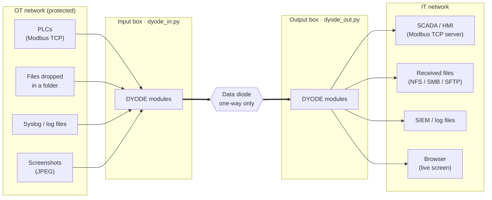

# DYODE — Python 3 edition

**DYODE (Do Your Own Diode)** moves data **one way only**, from an
operational (OT) network to an IT network. It runs on a pair of Linux boxes
on either side of a **data diode**: a link that physically can only carry
data in one direction. Nothing can travel back. No acknowledgements, no
retransmission requests, and no way for anything on the IT side to reach
into the OT side.

This wiki describes the **Python 3 port** in this repository (releases
1.x). It covers how the software works, what it can carry, how it is
installed, and how to operate and troubleshoot it.

## What it can carry

| Module type | Input side (OT) | Output side (IT) | Transport |
|---|---|---|---|
| [`folder`](Folder-Transfers) | Watches a folder and sends every new file, with subfolders | Verifies each file's SHA-256 and places it in the output folder | udpcast with forward error correction |
| [`modbus`](Modbus-Mirroring) | Polls PLC holding registers and coils | Serves the same values from its own Modbus TCP server | Framed UDP (v1) or serial (v2) |
| [`logs`](Log-Streaming) | Receives syslog (UDP/TCP) and follows log files | Writes log files and/or forwards to a SIEM | Compressed, numbered, duplicated UDP batches |
| [`screen`](Screen-Sharing) | Watches a folder of screenshots | Serves a live MJPEG stream over HTTP | Framed UDP |

A box can run any mix of modules at once. Each module runs as its own
supervised process.

## Two hardware variants

| | DYODE v1 (full) | DYODE v2 (light) |
|---|---|---|
| Link | Ethernet through a one-way fiber diode | Serial line through an optocoupler |
| Modules | `folder`, `modbus`, `logs`, `screen` | `modbus` |
| Folder in repo | `DYODE_v1_full/` (both sides) | `DYODE_v2_light/in/`, `DYODE_v2_light/out/` |
| Typical hardware | Servers or mini-PCs with SFP NICs | Raspberry Pi pair |

## Wiki pages

| Page | What it covers |
|---|---|
| [Architecture](Architecture) | Boxes, processes, supervision, the ARP keeper, wire framing |
| [Folder Transfers](Folder-Transfers) | Step-by-step data flow of a file, batches, verification, failure handling |
| [Modbus Mirroring](Modbus-Mirroring) | PLC polling and the mirrored Modbus server |
| [Log Streaming](Log-Streaming) | Syslog and file tailing, gap detection, forwarding |
| [Screen Sharing](Screen-Sharing) | Screenshots to a live browser view |
| [Installation and Setup](Installation-and-Setup) | Offline installer, setup wizard, systemd, file shares, kernel tuning |
| [Configuration Reference](Configuration-Reference) | Every `config.yaml` key |
| [Operations and Monitoring](Operations-and-Monitoring) | Logs, JSON events, rotation and archiving |
| [Troubleshooting](Troubleshooting) | Symptoms, causes and fixes, including large-transfer issues |

## Design principles

- **Nothing is trusted to "probably work".** udp-sender exiting 0 only
  means "transmitted", so every file is verified on arrival by SHA-256.
  Sent files are kept for 24 h in case a re-send is needed.
- **Loss is reported, never silent.** Missing files, log gaps and stale
  Modbus data are all named in the log and as JSON events.
- **No shell, no injection.** External programs are called with argument
  lists. Manifest paths are checked so a file can never land outside the
  output folder.
- **Offline first.** One release tarball installs on a machine with no
  internet access. Every file in the bundle is checksummed before anything
  changes.

Source: [nc-intezra/dyode_python3](https://github.com/nc-intezra/dyode_python3) ·
Original project: [wavestone-cdt/dyode](https://github.com/wavestone-cdt/dyode)
