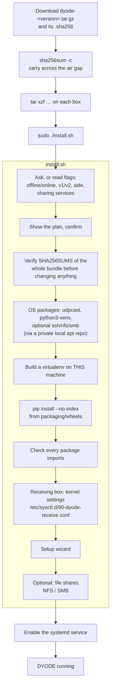
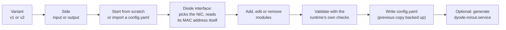
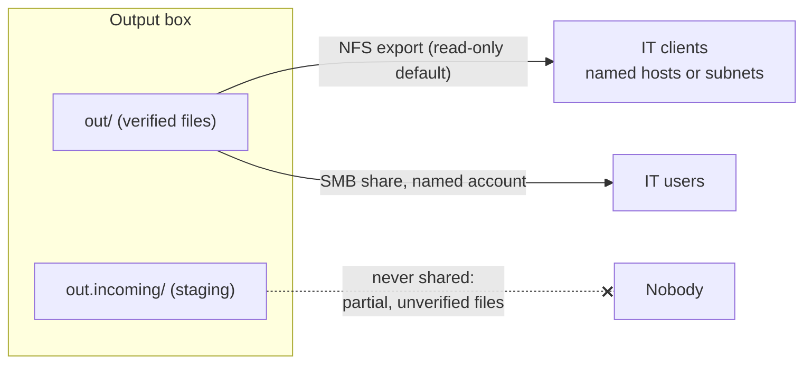

# Installation and Setup

Everything a box needs ships in **one release tarball**, including every
OS package and Python package. The same tarball installs on a machine with
no internet access.

## Supported systems

| System | CPU | Python |
|---|---|---|
| Ubuntu 24.04 LTS | amd64, arm64 | 3.12 |
| Ubuntu 26.04 LTS | amd64, arm64 | 3.14 |
| Raspberry Pi OS 12 "bookworm", 64-bit | arm64 | 3.11 |
| Raspberry Pi OS 13 "trixie", 64-bit | arm64 | 3.13 |

On another system with Python 3.11–3.14, install `udpcast` and
`python3-venv` by hand and run `install.sh --skip-os-packages`.

## From release to running service



### Common commands

```bash
sudo ./install.sh                                   # asks everything
sudo ./install.sh --offline                         # bundled files only, no network
sudo ./install.sh --offline --variant v2 --side out --yes --no-wizard   # unattended
sudo ./install.sh --with ssh,nfs,smb                # add file-sharing servers
sudo ./install.sh --with clients                    # only sftp / mount.nfs / mount.cifs / smbclient
sudo ./install.sh --shares-only --share-nfs /srv/dyode/out=10.0.2.0/24   # change shares later
sudo ./install.sh --tuning-only                     # (re)apply receive-side kernel settings
./install.sh --dry-run                              # show what would happen
```

Never copy a `venv/` folder between machines or folders. A virtualenv
records where it was made, so `install.sh` rebuilds it on each box.

## The setup wizard

`dyode_setup.py` (run by `install.sh`, or on its own) writes a validated
`config.yaml`:



On v1, **both boxes must use the same `config.yaml`**. Run the wizard on one
box, copy the file to the other, run it there to fill in that box's
interface and MAC, then copy the final file back.

### The systemd service

The generated `dyode-in.service` / `dyode-out.service`:

- starts after the network, and **waits for the diode NIC to have its
  address**;
- is **bound to the diode NIC**: it stops when the NIC disappears and starts
  again when it returns;
- restarts forever (`Restart=always`, with no start limit), because a diode
  box often has nobody watching it;
- runs as root (needed for the static ARP entry and for privileged ports)
  and creates `/var/log/dyode-transfer`.

```bash
sudo cp DYODE_v1_full/dyode-out.service /etc/systemd/system/
sudo systemctl daemon-reload && sudo systemctl enable --now dyode-out.service
journalctl -u dyode-out.service -f
```

## Optional: file shares

Either box can expose its DYODE folders, typically `out` on the output box
for IT users and `in` on the input box as a drop folder for OT users.



`install.sh` asks *"set up a file share now?"* after the wizard. For
unattended installs, pass `--share-nfs PATH=CLIENTS[:ro|:rw]` and
`--share-smb PATH=USER[:ro|:rw]`. Shares are written into one marked block in
`/etc/exports` and `smb.conf`, checked with `exportfs` and `testparm`, rolled
back on failure, and backed up. The installer refuses to:

- share a staging folder;
- export NFS to everyone;
- allow SMB guest or root access.

## Receive-side kernel settings

On a receiving box (v1, or v2 `--side out`), `install.sh` writes
`/etc/sysctl.d/90-dyode-receive.conf`:

| Setting | Value | Why |
|---|---|---|
| `vm.dirty_background_bytes` | 64 MB | Write received data to disk continuously, not in one burst every 30 s |
| `vm.dirty_bytes` | 20% of RAM, at most 2 GB | Headroom if the disk falls behind for a while |
| `net.core.rmem_default` / `rmem_max` | 8 MB / 16 MB | Room for short pauses at high bitrates |

Without these settings, files over about 1 GB failed part-way on fast links to
encrypted disks. See [Troubleshooting](Troubleshooting#large-transfers-fail-part-way).
Use `--no-tuning` to skip them, or `--tuning-only` to apply them to an
existing box.

## Upgrading

Upgrade **both boxes together**. Copy the new release over, run
`sudo ./install.sh` again on each box, and restart the services. Your
`config.yaml`, shares and settings are kept. A repeat run changes only what
differs.
