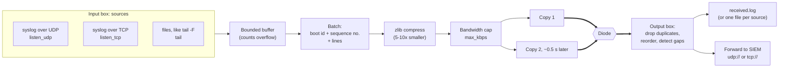

# Log Streaming

A `logs` module carries log lines one way, OT to IT. It typically gets
PLC, firewall or server logs from the OT network into an IT-side SIEM,
without opening any path back. *(DYODE v1 only.)*

## How it copes with a one-way link

| Problem | What DYODE does |
|---|---|
| A packet is lost | Every batch is sent **twice** (`copies: 2`), about half a second apart, so a loss burst must hit both copies |
| Both copies are lost | Each batch has a **sequence number**. The output box logs *"N log batch(es) lost in the diode"* and a `logs_gap` event, so nothing goes missing silently. |
| Duplicates and reordering | Duplicate batches are dropped. Batches are put back in order within a short reorder window. |
| The input box restarts | Each run has a new **boot id**. The output box sees a new stream (`logs_sender_restart`) rather than a huge gap. |
| Nothing is being logged | **Heartbeats** (every `heartbeat` s) keep the sequence moving. After `stale_after` s of silence the output box warns: link down, not just quiet. |
| A log storm on the OT side | `max_kbps` caps this module, so folder transfers on the same link are not starved. Lines dropped at the source are counted and reported. |

## Sources (input box)

- `listen_udp: 514`: classic syslog. Use `"10.0.0.1:514"` to bind one NIC.
- `listen_tcp: 601`: syslog over TCP. Both newline framing and RFC 6587
  octet counting are accepted.
- `tail: [/var/log/plc/*.log]`: follows files, including rotation and
  truncation. Globs pick up new files. `tail_state` remembers offsets
  across restarts.
- `allow_from: [192.168.1.0/24]`: accept syslog only from these networks.

## Destinations (output box)

- `out: /var/log/dyode-ot`: writes `received.log` there. It is
  logrotate-friendly. Set `split_by_source: true` for one file per sending
  host.
- `forward: [udp://10.20.0.5:514, tcp://siem.example:601]`: forwards to a
  SIEM or syslog server.
- `format`: `prefixed` (the default), `raw` or `json`.

Full details: [`LOG_STREAMING.md`](https://github.com/nc-intezra/dyode_python3/blob/master/DYODE_v1_full/LOG_STREAMING.md).
