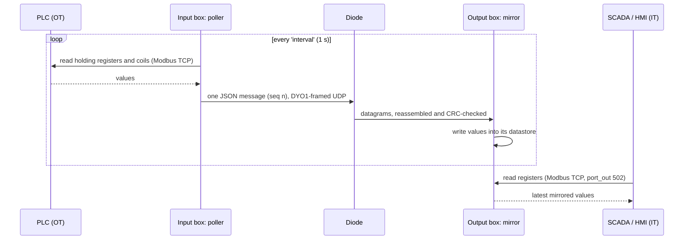
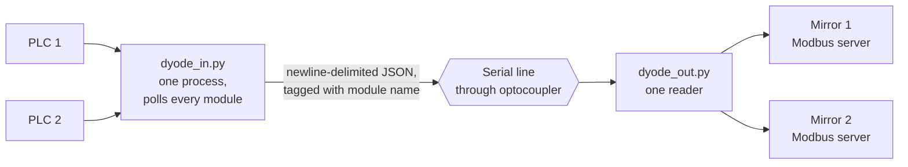

# Modbus Mirroring

A `modbus` module copies a PLC's **holding registers** and **coils** across
the diode. On the IT side they are served from a **Modbus TCP server**, so a
SCADA system, historian or HMI can read live values without any connection
into the OT network.



## How it works

- **Polling.** The input box keeps one TCP connection open to the PLC
  (`ip`, `plc_port` 502, `unit` 1) and reads every configured range each
  `interval` seconds. Large ranges are split to respect Modbus limits (125
  registers or 2000 coils per request). After any failure it reconnects,
  and failures are logged once rather than every second.
- **Sending.** All values from one poll travel as **one message**, with a
  sequence number. A message is either received whole and CRC-checked, or
  dropped whole, so a SCADA client never sees half an update.
- **Serving.** The output box listens on `dyode_out.ip:port` for updates and
  runs a Modbus TCP server on `port_out` (default 502, all interfaces, or
  `bind_out`). Values out of range or outside the configured datastore are
  rejected and logged.
- **Staleness.** If no update arrives for `stale_after` seconds (default
  10), the output box logs *"no update for Ns, serving stale values"*. The
  server keeps answering with the last values, because Modbus has no way to
  say "stale", so **the log is the only signal**. Watch for it.
- **Read-only.** The output box's server refuses every write with Modbus
  exception 01 (Illegal Function), logged at most once a minute. Only values
  that came through the diode are ever served, and nothing can reach the PLC.
- **Unmapped addresses.** A read touching an address outside the
  configured ranges gets exception 02 (Illegal Data Address), so a client
  can tell "not mirrored" from "value 0". Set `unmapped: zero` for a SCADA
  that polls a wider block than you mirror.
- **Signed.** Each update carries the shared key's signature (see
  [Security](Security)); a forged or replayed update is dropped.

## Address ranges

Ranges are written `start-end` with the **end excluded**:

```yaml
registers:
  - 0-100      # holding registers 0..99
  - 400-450    # 400..449
coils:
  - 0-10       # coils 0..9
```

## DYODE v2: over a serial optocoupler



DYODE v2 supports only `modbus` modules. A single process owns the serial
port (`serial.device`, default `/dev/serial0`, 57600 baud) and multiplexes
every module over it. Any other module type in a v2 config is ignored with
a warning.
