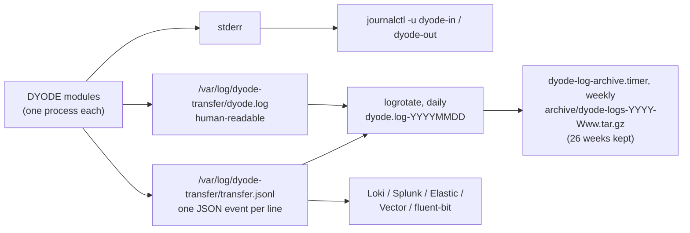
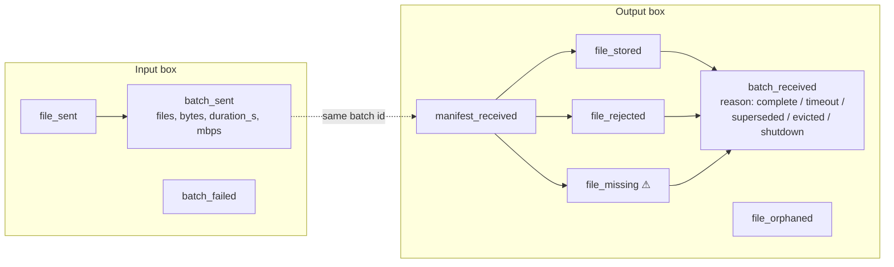

# Operations and Monitoring

## Where to look



| Want to… | Command |
|---|---|
| Watch live | `journalctl -u dyode-out.service -f` |
| See today's transfers | `less /var/log/dyode-transfer/dyode.log` |
| Summarize transfer events | `sudo DYODE_v1_full/venv/bin/python dyode_logs.py --stats` (from the repo folder) |
| Check the service | `systemctl status dyode-in.service` |
| Check the ARP entry (input box) | `ip neigh show <dyode_out.ip>` (should say `PERMANENT`) |

## JSON events

`transfer.jsonl` gets one object per line, with a schema version `v`, a UTC
timestamp `ts`, the `event` name, the `side` and the `module`. The batch id
is the same on both boxes, so sent and received can be matched up.



| Event | Side | Meaning |
|---|---|---|
| `batch_sent` | in | A batch went out. Includes `duration_s` and `mbps`, the throughput trend. |
| `batch_failed` | in | The manifest could not be sent |
| `manifest_received` | out | A batch was announced |
| `file_stored` | out | A file was verified and delivered |
| `file_rejected` | out | A received file matched nothing expected, or had an unsafe path |
| **`file_missing`** | out | **A promised file never arrived. Alert on this.** |
| `file_orphaned` | out | A file arrived with no batch open |
| `batch_received` | out | A batch closed, with stored, rejected and missing counts |
| `logs_gap`, `logs_stale`, `logs_resumed`, `logs_sender_restart`, `logs_dropped_at_source`, `logs_stats` | either | Log streaming health |

**The two boxes count different things.** The input box knows what it
sent; the output box knows what arrived. On a diode those can legitimately
differ, and neither box can see the other's logs. To compare them, collect
the output box's logs on the IT side, and the input box's logs on the OT
side.

## Setting up log rotation and archiving

```bash
sudo cp packaging/logrotate/dyode-transfer /etc/logrotate.d/
sudo cp packaging/systemd/dyode-log-archive.* /etc/systemd/system/
sudo systemctl daemon-reload
sudo systemctl enable --now dyode-log-archive.timer
```

The archive runs on Mondays at 03:20. It catches up after downtime, so
a box that is off on a Monday still archives, and it never touches the live
log files.

## Recovering a file that never arrived

1. On the output box, find it: `file_missing` / *"file X never arrived"*.
2. On the input box it is still in `<in>/.dyode_sent/X` for 24 h.
3. Copy it back into `<in>/` and it is sent again in a new batch.

## Health checklist

- [ ] `systemctl status` shows `active (running)` on both boxes
- [ ] Input box: the ARP entry for the output box is `PERMANENT`
- [ ] No `file_missing` events since the last check
- [ ] Modbus: no *"serving stale values"* warnings
- [ ] Logs: no `logs_gap` or `logs_stale`
- [ ] Receiving box: `/etc/sysctl.d/90-dyode-receive.conf` is present and is the only DYODE sysctl file
