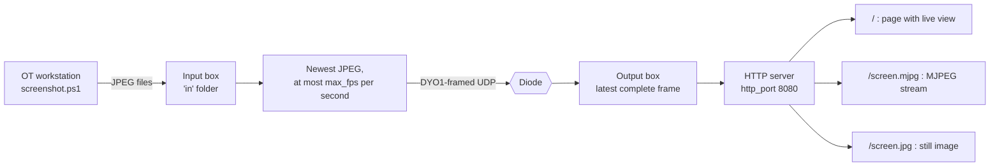

# Screen Sharing

A `screen` module shows a live picture of an OT screen, such as an HMI or
an engineering workstation, in an IT-side web browser, through the diode.
*(DYODE v1 only.)*

## How it works

1. Something on the OT side writes JPEG screenshots into a folder that the
   input box can read. `screenshot.ps1` is included for Windows.
2. The input module watches the folder and sends the **newest** image as
   one framed message, at most `max_fps` times per second (default 10).
   Older images that were superseded are simply skipped.
3. The output module keeps the latest **complete** frame. Each frame is
   CRC-checked, so a damaged frame is dropped and never shown.
4. Browse to `http://<output-ip>:8080/` for a live view. `/screen.jpg` gives
   a single still, handy for dashboards.

There is no keyboard or mouse path. The picture is strictly view-only,
because nothing can travel back through the diode.
