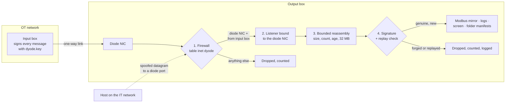
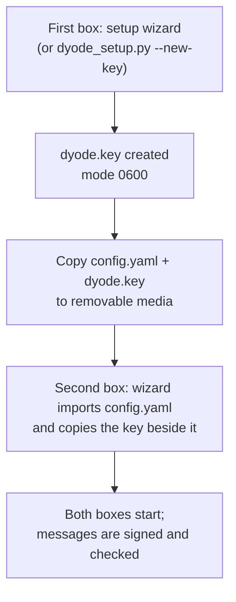

# Security

A data diode guarantees that nothing travels from the output box back to
the OT side. It cannot stop someone on the **IT side** from sending traffic
*to* the output box and pretending it came through the diode. From 1.5.0,
DYODE defends that edge in four layers.



| Layer | What it stops | Where |
|---|---|---|
| Firewall | Datagrams for a diode port arriving on another NIC, from another address, or over IPv6 | `install.sh` (nftables) |
| Interface binding | The same, if the firewall is removed (Modbus, logs, screen) | `SO_BINDTODEVICE` |
| Bounded reassembly | Memory floods from partial or oversized messages | `dyode_common.Reassembler` |
| Message authentication | Forged or replayed Modbus values, log lines, screen frames and file manifests | HMAC-SHA256 with `dyode.key` |

## The key: `dyode.key`

Both v1 boxes share one secret key, a file beside `config.yaml`. DYODE will
not start without it (unless `auth.required: false`).



- The wizard **never makes a second key** on a box that imported its
  configuration: it copies the key found beside the imported file, or tells
  you to bring it over.
- Treat the key like a password. Keep it off file shares and out of e-mail.
- To change it, delete it on **both** boxes, create a new one on one box and
  copy it to the other.

Each message carries a random sender id and a counter, so a captured message
replayed later is refused. Signed file manifests list every file's SHA-256,
so a file that does not match a signed manifest is discarded.

## The firewall

On a receiving box (v1), `install.sh` installs one nftables table,
`inet dyode`, built from `config.yaml`:

```
udp dport { diode ports } on IPv6              -> drop
udp dport { diode ports } not on the diode NIC  -> drop
udp dport { diode ports } not from dyode_in.ip  -> drop
```

Every other port and rule on the box is untouched. The Modbus server
(`port_out`, 502) and the screen viewer (`http_port`) face the IT network by
design and are not filtered. The rules are saved as
`/etc/dyode/firewall.nft` and loaded at boot by `dyode-firewall.service`.

```bash
sudo ./install.sh --no-firewall         # install without the rules
sudo ./install.sh --firewall-only       # (re)apply after editing config.yaml
sudo nft list table inet dyode          # counters show what was dropped
```

## On the output box's own services

- **Modbus mirror is read-only.** Client writes get exception 01 (Illegal
  Function). Reads outside the configured ranges get exception 02 (Illegal
  Data Address), or 0 with `unmapped: zero`.
- **Received files are never placed through a symlink.** A link inside
  `out/` (from a read-write share, say) cannot redirect a file elsewhere.
- **The input box sends exactly the file it checked.** A file swapped for a
  link after the scan is not followed.
- **Screen viewer:** listens on the IT-side address by default (not the
  diode NIC), with at most `max_streams` (8) viewers.
- **NFS exports** of a folder inside a larger filesystem use
  `subtree_check`. A dedicated filesystem for `out/` is stronger still.

## Limits

- **DYODE v2 (serial) is not authenticated.** The optocoupler link is
  physically one-way and point-to-point, with no network to spoof from.
- **udpcast itself is not authenticated.** Anyone who gets past the firewall
  can still make `udp-receiver` write data, but without a signed manifest it
  is discarded.
- **Replay protection lasts while the output service runs.** After a
  restart, a recorded batch could be accepted once more. That can only bring
  back files that were genuinely sent before.
- **Anyone with `dyode.key` can forge messages.** Protect it like the
  configuration of the input box itself.

See also [CAVEATS.md](https://github.com/nc-intezra/dyode_python3/blob/master/CAVEATS.md#security-150).
