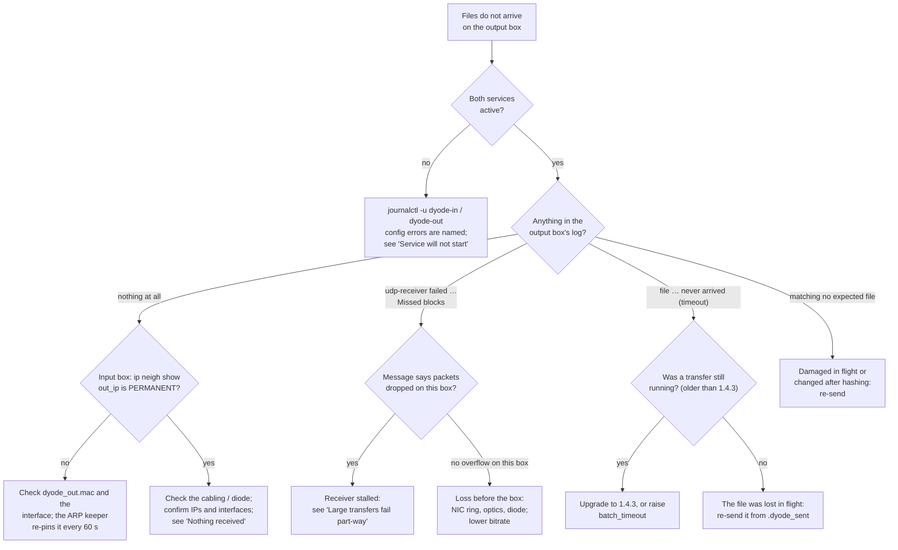
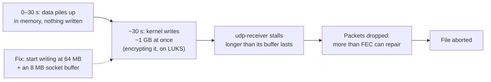

# Troubleshooting

Start from what you see, follow the branch, and use the matching section
below. The full background is in
[`CAVEATS.md`](https://github.com/nc-intezra/dyode_python3/blob/master/CAVEATS.md).



## Service will not start

- **Configuration error.** The message names the module and the key. Fix
  `config.yaml` and restart.
- **Input box: "cannot set the static ARP entry … refusing to start".**
  The diode NIC is down, has no address, or `dyode_out.mac` /
  `dyode_in.interface` is wrong. systemd keeps retrying, and DYODE starts
  by itself once the NIC is ready.
- **"udp-sender not found".** Install udpcast (`sudo ./install.sh`).

## Nothing received

- Run `ip addr` on both boxes. Each diode NIC must have the address in
  `config.yaml` (`dyode_in.ip`, `dyode_out.ip`), and they must be on the
  same subnet.
- On the input box, `ip neigh show <out_ip>` must show the output box's MAC
  as `PERMANENT`.
- The **input box's** TX counters (`ip -s link`) should rise during a send,
  and the **output box's** RX counters should rise too. A few TX drops on
  the *output* box are normal: it cannot send anything through the diode,
  so its own ARP, IPv6 and DHCP traffic is discarded.
- An *"idled out after 300 s with no sender"* message on the output box is
  **normal** on a quiet link. It is logged once, then at debug level.

## Large transfers fail part-way

**Symptom:** small files arrive, but files from about 1 GB up fail after
roughly 30–40 s with `Missed blocks: …`, typically with a high `bitrate` and
an encrypted (LUKS) receive disk.

**Cause:** the receiving box wrote about 30 s of incoming data to disk in
one burst. That stalled `udp-receiver` long enough to overflow its socket
buffer. A diode cannot re-send, so the file was lost.



**Fix:** the receive-side kernel settings, which 1.4.2 and later install
automatically:

```bash
sudo ./install.sh --tuning-only
sysctl vm.dirty_background_bytes vm.dirty_bytes net.core.rmem_default
```

**Diagnose:** run this on the receive box during a test transfer.

```bash
s() { awk '/^Udp:/{n++; if(n==2) print $6}' /proc/net/snmp; }
while sleep 1; do
  printf "%s rcvbuf_err=%s dirty=%s wb=%s\n" "$(date +%T)" "$(s)" \
    "$(awk '/^Dirty:/{print $2"k"}' /proc/meminfo)" "$(awk '/^Writeback:/{print $2"k"}' /proc/meminfo)"
done
```

| What you see | Meaning |
|---|---|
| `rcvbuf_err` jumps as `dirty` spikes and `wb` surges | Writeback bursts: apply the fix above |
| `rcvbuf_err` jumps while `dirty` stays low | A CPU stall: governor, IRQ affinity (see CAVEATS.md) |
| `dirty` climbs steadily for the whole transfer | The disk cannot sustain the link: lower `bitrate` |
| Nothing rises, but transfers fail | Loss before the box: optics, NIC ring, diode |

**Check the disk can keep up.** Write more than your largest file,
bypassing the cache:

```bash
dd if=/dev/zero of=./ddtest bs=1M count=20000 oflag=direct status=progress; rm ./ddtest
```

Keep `bitrate` below the slowest sustained rate it shows. A gigabit diode
needs about 120 MB/s.

## Very large files discarded after five minutes

**Before 1.4.3:** a single file that took longer than `batch_timeout`
(300 s) to transfer had its batch closed while it was still arriving. It
was then discarded with *"received a file with no manifest pending"*. At
the ~350 Mbit/s the default FEC allows, that hits files of about 10 GB.

**Fix:** upgrade to 1.4.3, where data still arriving keeps the batch open.
On older versions, set `batch_timeout: 3600` in the receiving folder module.

## Slow transfers

- With the default FEC, about 350–400 Mbit/s on a gigabit link is the
  expected ceiling on server hardware. The single-threaded encoder is the
  limit, not the link.
- `fec: none` reaches line rate, but any lost packet then costs the whole
  file. Use it only on a short, clean, dedicated link.
- Many small files are slowed by `autostart` (hello packets before each
  file) and `file_gap`. Lower them carefully; raise them again if files go
  missing.

## Modbus values not updating

- On the output box, *"no update for Ns, serving stale values"* means
  updates stopped. Check the input box's log for PLC connection errors
  (`ip`, `plc_port`, `unit`).
- *"outside datastore … ignored"* means a configured range on one side does
  not match the other. Both boxes must use the same `config.yaml`.
